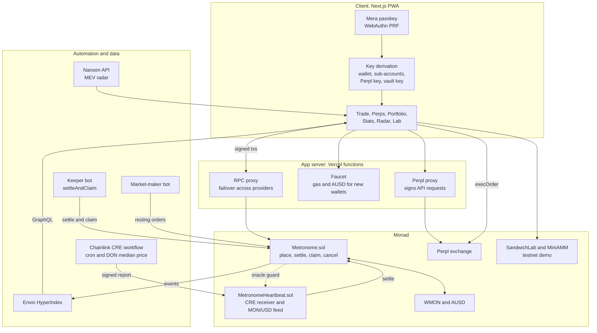
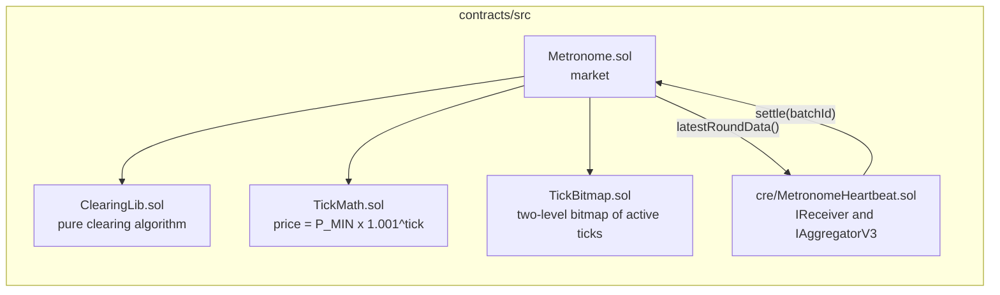
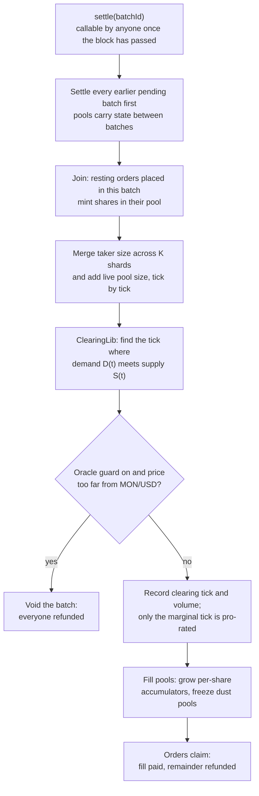
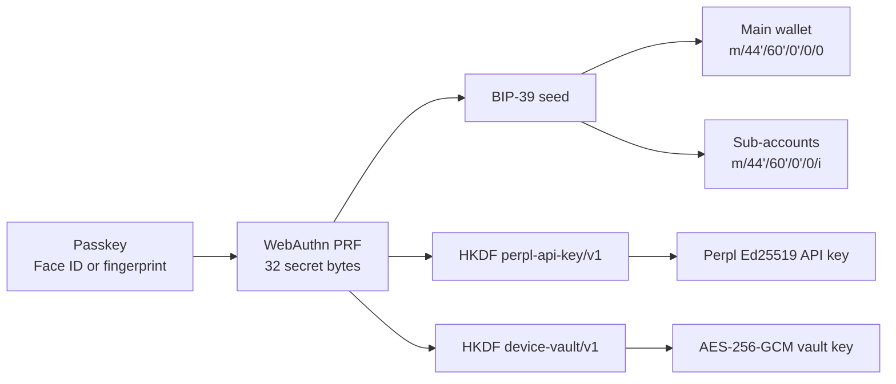
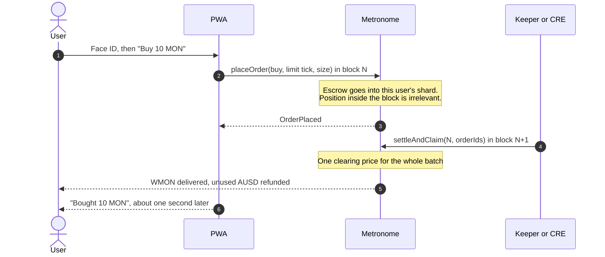
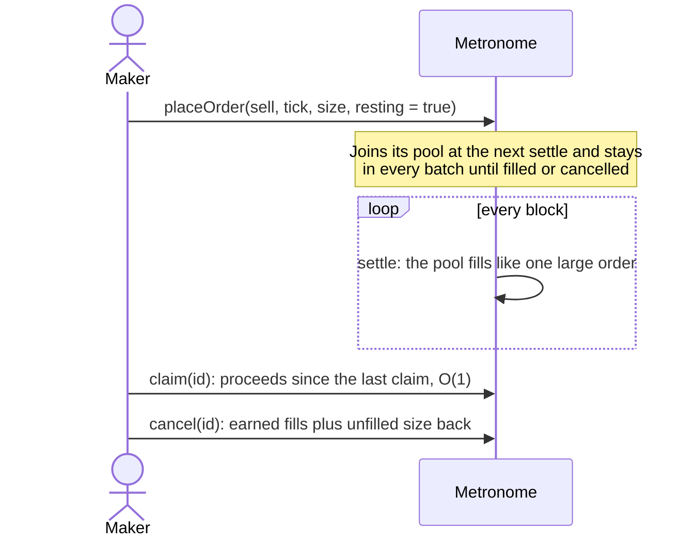
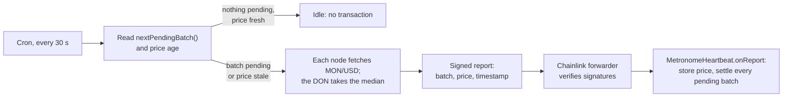
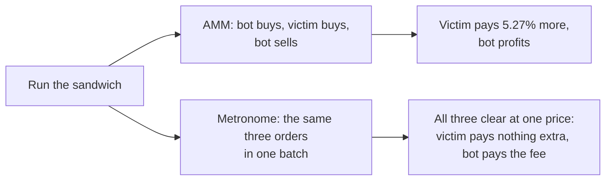

<p align="center">
  
</p>

<h1 align="center">Metronome</h1>

<p align="center">
  <strong>Fair execution for Monad. Every block is one auction, and everyone in it gets the same price.</strong>
</p>

<p align="center">
  A fully onchain frequent batch auction exchange: no offchain matching engine, no solvers, no trusted sequencer.<br>
  Front-running and sandwich attacks stop working because the order of transactions inside a block no longer matters.
</p>

<p align="center">
  <a href="https://metronome-monad.vercel.app"><strong>Live app</strong></a> ·
  <a href="#deployments">Mainnet contracts</a> ·
  <a href="#architecture">Architecture</a> ·
  <a href="#hackathon-tracks">Tracks</a> ·
  <a href="#roadmap">Roadmap</a> ·
  <a href="docs/demo.md">Demo guide</a>
</p>

<p align="center">
  Built by <strong>Team BROTHERHOOD</strong> for <a href="https://monad.xyz/developers/hackathons/metropolis">Monad Metropolis</a> · Track 01: Onchain Finance &amp; Trading
</p>

---

## Contents

1. [At a glance](#at-a-glance)
2. [The problem](#the-problem)
3. [The solution](#the-solution)
4. [Why Monad](#why-monad)
5. [Deployments](#deployments)
6. [Architecture](#architecture)
7. [Workflows](#workflows)
8. [Features](#features)
9. [Technology and integrations](#technology-and-integrations)
10. [Hackathon tracks](#hackathon-tracks)
11. [Testing and security](#testing-and-security)
12. [Running it locally](#running-it-locally)
13. [Repository layout](#repository-layout)
14. [Roadmap](#roadmap)
15. [Team and license](#team-and-license)

---

## At a glance

| | |
|---|---|
| **What** | An exchange that clears every Monad block as a single auction at one uniform price |
| **Market** | WMON / AUSD (Agora's dollar stablecoin) |
| **Mainnet** | Market [`0xd9eD8A732D8daE96855b40e1ebD65E9d36583ea1`](https://monadscan.com/address/0xd9eD8A732D8daE96855b40e1ebD65E9d36583ea1), source verified |
| **App** | Mobile-first web app with passkey login: [metronome-monad.vercel.app](https://metronome-monad.vercel.app) (runs on testnet with free test funds) |
| **Settlement** | Anyone can settle; a keeper bot and a Chainlink CRE workflow do it automatically |
| **Fees** | Takers 5 bps, makers 0 |
| **Tests** | 112 Foundry tests (unit, differential fuzz, invariants, gas, mainnet fork) plus Go workflow tests, all in CI |

---

## The problem

On today's onchain exchanges, **whoever gets ordered first wins**.

- **AMMs.** Each swap moves the price for the next one. A bot that sees your swap buys just before you and sells just after. You pay more and the bot keeps the difference. This is a sandwich attack.
- **Order books.** Matching is first come, first served. Speed and transaction ordering decide who gets filled, so trading turns into a latency race that ordinary users always lose.

Either way, users pay a hidden tax to whoever controls transaction ordering. Retail and mobile users, who tend to set loose slippage limits, pay the most. On Monad mainnet our MEV radar found that **five bot wallets made 75% of all WMON trades** over a 5.6 hour window (5,000 trades, $723k volume).

## The solution

Metronome replaces "first come, first served" with **"everyone in the same block, at the same price"**.

1. A user places a limit or market order at any point during a block.
2. When the block closes, every order in it clears **together** at one price: the price where supply meets demand.
3. Funds arrive a moment later, automatically.

Because every order in a batch receives the same price, being first inside the block is worth nothing:

| Sandwich step | On an AMM | On Metronome |
|---|---|---|
| Bot buys before you | Pushes your price up | Joins the same batch as you |
| You buy | You pay the inflated price | You pay the batch clearing price |
| Bot sells after you | Bot keeps the difference | Bot's buy and sell clear at the same price: profit 0, minus fees |
| **Your loss** | **Up to your full slippage limit** | **Zero** |

This market design, the frequent batch auction, was proposed by economists as the fix for high-frequency trading races. Metronome runs it entirely onchain, every block.

**Measured, not claimed.** The in-app Sandwich Lab runs the same 100,000 MON attack against an AMM and against Metronome on Monad testnet: the AMM victim overpays **5.27%**, the Metronome victim **0%** ([attack](https://testnet.monadscan.com/tx/0x12915a346f7d4199f954d7c26e35b5f7bf783997ddf7a1577c70292a7c209712), [settle](https://testnet.monadscan.com/tx/0xa152acebf1f269c2efc30f80c02582f359d06322ded676bfac6da53264a66884)).

### Compared with the alternatives

| | AMM | Onchain order book | Offchain batch auction | **Metronome** |
|---|---|---|---|---|
| Sandwich-proof | No | Partly | Yes | **Yes** |
| Matching fully onchain | Yes | Yes | No | **Yes** |
| Ordering inside a block matters | Yes | Yes | No | **No** |
| Needs trusted solvers or operators | No | No | Yes | **No** |
| Limit orders | No | Yes | Yes | **Yes** |
| Price discovery | Formula | Continuous | Per batch | **Every block** |

---

## Why Monad

A batch auction only works if batches are **short** (prices stay fresh), **cheap to clear** (it can run onchain) and **fairly ordered** (no sequencer picks winners). Monad is the first chain where all three hold at once.

| Chain | One batch = one block | Consequence |
|---|---|---|
| Ethereum | 12 s | Stale prices; onchain clearing is too expensive |
| Rollups | 0.25 to 2 s | One sequencer orders everything; clearing gas still adds up |
| Offchain batch auctions | Varies | Matching runs offchain, through solvers you must trust |
| **Monad** | **Sub-second blocks, fast finality, low gas** | **Real-time feel, fully onchain, nobody to trust** |

### Engineered for parallel execution

Monad runs transactions in parallel and re-executes those that touched the same storage. A naive exchange, where every order writes the same bucket, becomes a serial bottleneck. Metronome avoids that by design:

- **Sharded books.** Each batch's book is split into K shards; a user always writes to their own shard, so orders from different users do not collide.
- **No global counters.** Order IDs come from a per-user nonce, so placing an order touches only the user's own storage and their shard.
- **Page-aware layout.** Price levels sit in fixed contiguous arrays, so neighbouring prices share a storage page and settlement reads fewer pages.
- **Transient-storage reentrancy guard.** The usual guard writes one shared slot on every call; ours does not.
- **Benchmarked.** With 200 orders in one batch, sharding cuts the chain of conflicting writes inside Metronome from 24 (K=1) to 10 (K=16). The benchmark also exposes the next bottleneck, the token transfer into escrow, which the roadmap removes with internal balances ([details](docs/benchmark.md)).

---

## Deployments

### Monad mainnet (chain 143)

Deployed October 12, 2026. Both contracts are source verified on Sourcify (exact match).

| Contract | Address |
|---|---|
| **Metronome** (WMON/AUSD market) | [`0xd9eD8A732D8daE96855b40e1ebD65E9d36583ea1`](https://monadscan.com/address/0xd9eD8A732D8daE96855b40e1ebD65E9d36583ea1) |
| **MetronomeHeartbeat** (Chainlink CRE receiver and MON/USD feed) | [`0xaA48F3ec9F1044c6ba61572Eb475522C96f9b69b`](https://monadscan.com/address/0xaA48F3ec9F1044c6ba61572Eb475522C96f9b69b) |
| WMON (base token) | [`0x3bd359C1119dA7Da1D913D1C4D2B7c461115433A`](https://monadscan.com/address/0x3bd359C1119dA7Da1D913D1C4D2B7c461115433A) |
| AUSD (quote token) | [`0x00000000eFE302BEAA2b3e6e1b18d08D69a9012a`](https://monadscan.com/address/0x00000000eFE302BEAA2b3e6e1b18d08D69a9012a) |

Configuration: 4 shards, tick 2048 = 0.02618 AUSD per MON, price band of 128 ticks around the last clearing price, minimum order 1 MON, taker fee 5 bps.

Verified live on mainnet:

| Check | Transaction |
|---|---|
| Chainlink CRE report writes MON/USD on-chain | [`0x6b27…a3b3`](https://monadscan.com/tx/0x6b2734034d0aaf904e5821571d5e1f9ded9db2cff39c71547de65a85c737a3b3) |
| Chainlink CRE settles a pending batch | [`0x9bf7…244b`](https://monadscan.com/tx/0x9bf7cb931f3c1005a8ac6cef87c7b8cb8682971fb16cedfcc5dcee029e6f244b) |
| Order placed, then settled and refunded in full (`pnpm smoke`) | [`0xf3db…6235`](https://monadscan.com/tx/0xf3db82677af2f1644e16d8cbc949ab06fb2c5a62992ba4253481ec116cfc6235) |
| Resting order posted, joined its pool, cancelled | [`0x6244…a608`](https://monadscan.com/tx/0x6244c9e5058aebae1b8e1d790b9748877a522dfec764c48a6a1b52cbe58ea608) |

### Monad testnet (chain 10143)

The hosted app runs here so judges and new users can trade with free test funds.

| Contract | Address |
|---|---|
| Metronome (WMON/AUSD) | [`0x44F6cF1A3c61AfCeAfF5017CA054b5754C2110E5`](https://testnet.monadscan.com/address/0x44F6cF1A3c61AfCeAfF5017CA054b5754C2110E5) |
| MetronomeHeartbeat | [`0xBF310973D31a3766A1c943003f826a56F1986819`](https://testnet.monadscan.com/address/0xBF310973D31a3766A1c943003f826a56F1986819) |
| SandwichLab (with MiniAMM and a lab market) | [`0xc2E9492f6b45c9e709e2e4a43FBfD505Bf71f01b`](https://testnet.monadscan.com/address/0xc2E9492f6b45c9e709e2e4a43FBfD505Bf71f01b) |
| Keeper wallet | [`0xF017E98A274897F499eE8D53D08C50D3Da521eAB`](https://testnet.monadscan.com/address/0xF017E98A274897F499eE8D53D08C50D3Da521eAB) |

Every verified address, including tokens, oracles and Chainlink forwarders, is listed in [`docs/network.md`](docs/network.md).

### Hosted services

| Service | Where |
|---|---|
| Web app | Vercel: [metronome-monad.vercel.app](https://metronome-monad.vercel.app) |
| Keeper | Render: [metronome-keeper.onrender.com/health](https://metronome-keeper.onrender.com/health) |
| Indexer | Envio Cloud, public GraphQL: `https://indexer.dev.hyperindex.xyz/5cebe67/v1/graphql` |

---

## Architecture

### System overview



There is no custodial backend. Every trade is signed in the browser with a key derived from the user's passkey. The Vercel functions only proxy RPC traffic, pay gas for new testnet wallets and sign Perpl API reads. The keeper is a convenience: anyone can call `settle`, and the Chainlink workflow does the same job independently.

### Smart contracts



| Concept | Meaning |
|---|---|
| **Batch** | All orders placed in one block (`batchId = block.number`) |
| **Tick** | A price level, 10 bps apart: `price(t) = P_MIN x 1.001^t`, with `t` in `[0, 4095]` |
| **Shard** | Each batch's book is split into K copies; a user writes to shard `owner % K` |
| **Taker order** | Lives for one batch; whatever does not fill is refunded |
| **Resting order** | A maker order: joins the pool for its side and tick and stays in every batch until filled or cancelled |
| **Pool** | All resting orders at one side and tick, treated as one order; makers own shares of it |
| **Clearing tick** | The single price every fill in a batch trades at |

**Storage design.** An order takes 2 slots. Each (batch, shard) pair has its own book: a bitmap of active ticks and fixed arrays of taker and resting size per tick. Pools are fixed arrays per side with per-share accumulators, so a maker's claim costs O(1) however many batches the pool traded in. Full layout: [`docs/architecture.md`](docs/architecture.md).

### Clearing a batch



- **Cost scales with price levels, not orders.** Settling 10 orders or 10,000 costs the same; the bitmap skips empty ticks.
- **One price for everyone.** Every order at a better price fills completely, the marginal tick is shared pro-rata, and every worse price is refunded.
- **Conservative rounding.** What a user gives is rounded up and what they receive is rounded down, so the contract can never owe more than it holds. The invariant suite checks this continuously.
- **Price band.** After the first trade, orders must sit within 128 ticks (about 13.7%) of the last clearing price, which caps settlement gas however many pools an attacker creates.

### Passkey keys (Mera)



Nothing is stored. A synced passkey on a new device recovers every key, and each key comes from its own derivation path, so leaking one reveals nothing about the others.

---

## Workflows

### A trade, end to end



### Market maker (resting orders)



Makers post once instead of every block, pay no fee, and are never picked off by faster bots inside a batch.

### Chainlink CRE heartbeat



Settlement does not depend on our servers staying up. One report catches up on every pending batch, the stored price feeds the market's oracle guard, and each report's gas limit is sized from a live estimate because Monad bills the full gas limit.

### Sandwich Lab



---

## Features

**Trading**
- One-tap market and limit orders on WMON/AUSD, with the batch and clearing price shown on every fill.
- Automatic settlement and payout: no claim button, funds arrive in about a second.
- Resting (maker) orders that post once and earn fills across batches, with zero maker fee.
- Live supply and demand curves that cross every block, and a page for every batch.

**Wallet and onboarding**
- Face ID or fingerprint login through Mera passkeys: no seed phrase, no extension, no popups.
- Sub-accounts from the same passkey, switchable in one tap.
- New wallets get gas and AUSD from a built-in faucet on testnet, so a first trade takes under a minute.

**Perpetuals**
- Perpl markets with live prices, candles and order book.
- Open a Perpl account and trade long or short with leverage from the same passkey wallet, with live position and P&L.

**Transparency**
- Portfolio with every Metronome order and Perpl position.
- Stats page (volume, batches, traders, settlement latency, gas per action) from the Envio indexer.
- MEV radar on Monad mainnet from Nansen data: who trades WMON, bots versus humans, sandwich candidates verified block by block.
- Sandwich Lab: the same attack on an AMM and on Metronome, side by side.

---

## Technology and integrations

| Technology | What we use it for | Why it makes Metronome better |
|---|---|---|
| **Monad** | Execution layer; one batch per block | Short, cheap, fairly ordered blocks are what make an onchain batch auction practical, and parallel execution rewards our sharded layout |
| **Chainlink CRE** | Workflow that settles batches and brings MON/USD on-chain through a DON median | Settlement keeps running even if our keeper is down, and the same report feeds an oracle guard that voids batches clearing far from the real price |
| **Mera** | Passkey login and key derivation | Removes the biggest barrier for mobile users: no seed phrase, no extension, no signing popups. One passkey derives every key the app needs |
| **Agora AUSD** | Quote asset of the market and Perpl collateral | A dollar stablecoin users understand; one balance works across spot and perps |
| **Perpl** | Perpetual futures in the same app | Users can hedge or take leverage without leaving the app or creating another wallet |
| **Envio HyperIndex** | Indexer behind Stats and portfolio history | Fast history and aggregates without scanning logs from the browser; totals are checked against raw chain logs |
| **Nansen** | MEV radar on Monad mainnet | Real data on who extracts value from traders today, which is the problem Metronome solves |
| **Foundry** | Contracts, fuzzing, invariants, fork tests, deployment | Differential fuzzing checks the clearing algorithm against a brute-force reference |
| **Next.js, viem, Tailwind** | Installable mobile PWA | Works in any phone browser and installs to the home screen |

---

## Hackathon tracks

| Prize | What we submit | Integration |
|---|---|---|
| **Track 01: Onchain Finance & Trading** | Metronome: batch auction contracts, mobile app, keeper and market-maker bots | Full: contracts on mainnet, app live on testnet |
| **Grand Champion** | The same project | Considered automatically |
| **Agora: Best Mobile Trading App** | Passkey login, AUSD balance, Metronome and Perpl trades in one mobile app | Full on testnet |
| **Mera: Best Mera-Powered UX** | Face ID login and popup-free signing for every action | Full |
| **Mera: One Passkey, Many Keys** | One passkey derives the wallet, sub-accounts, a Perpl Ed25519 key and a device vault key | Full |
| **Perpl: Best Use of Perpl's API** | Perps tab: market data over the API, account setup and trading on Perpl's contract | Market data, account and trading live; in-app API order entry awaits Perpl's origin whitelist |
| **Chainlink: Best CRE Workflow** | Heartbeat workflow that settles batches and writes a DON-median MON/USD price | Live on mainnet and testnet through `simulate --broadcast` |
| **Nansen: Best Use of Nansen** | MEV radar on Monad mainnet trade data | Built; runs as a snapshot on the free plan |
| **Envio: Best Use of Envio** | Hosted indexer behind Stats and portfolio | Full, on Envio Cloud |

Why these integrations belong together: each one removes a reason an ordinary user would not trade onchain. Metronome removes the MEV tax, Mera removes the seed phrase, AUSD gives a familiar dollar balance, Perpl adds hedging in the same wallet, Chainlink removes the dependency on our servers, and Envio and Nansen make the results visible. Details per bounty: [`tracks/`](tracks/README.md).

---

## Testing and security

| Suite | What it proves |
|---|---|
| Unit tests | Every place, settle, claim and cancel path, escrow maths, events and reverts |
| Differential fuzz | `ClearingLib` matches a brute-force search over every tick: same price, same volume |
| Invariants | The contract always holds what it owes; no fill is worse than its limit; only the marginal tick is rationed; an order is claimed once; pools stay consistent |
| Gas and shard benchmarks | Settlement cost against active ticks; conflict chains for K = 1, 4, 16 |
| Mainnet fork | The full cycle against real WMON and AUSD |
| Go workflow tests | CRE workflow: report encoding, gas sizing, idle path, price failures |
| End to end | `pnpm e2e:local` runs contracts, keeper, market maker and 60 takers on a local chain; `pnpm smoke` checks a deployed market |

Security measures: reentrancy guard on every entry point, checks-effects-interactions, SafeERC20, a minimum order size, the price band against settlement-gas griefing, an oracle guard with staleness and deviation checks, and a pause that blocks new orders while claims and cancels keep working. Internal review: [`docs/audit-2026-10-06.md`](docs/audit-2026-10-06.md). The contracts have not had an external audit yet.

---

## Running it locally

Requirements: Node.js, pnpm and [Foundry](https://getfoundry.sh).

```bash
pnpm install

# Contracts: build and run the full test suite
cd contracts && forge test && cd ..

# Full local stack in one command: Anvil, contracts, keeper, market maker and 60 takers
pnpm e2e:local

# Web app against a local chain
pnpm dev:local          # terminal 1: chain, contracts and bots
pnpm web:dev            # terminal 2: http://localhost:3000

# Check a deployed market end to end (needs a funded key)
NETWORK=mainnet PRIVATE_KEY=0x... pnpm --filter @metronome/bots smoke
```

Deployment, the CRE workflow and the indexer each have their own guide: [`contracts/README.md`](contracts/README.md), [`cre/metronome-heartbeat/README.md`](cre/metronome-heartbeat/README.md), [`indexer/README.md`](indexer/README.md).

---

## Repository layout

```
contracts/   Foundry: Metronome.sol, ClearingLib, TickMath, TickBitmap, CRE receiver, demo AMM and lab, tests, scripts
bots/        TypeScript: keeper, keeper service, market maker, taker, smoke test, local end-to-end test, MEV radar
web/         Next.js PWA: trade, perps, portfolio, stats, radar, sandwich lab; RPC, faucet and Perpl API routes
cre/         Chainlink CRE workflow in Go: metronome-heartbeat
indexer/     Envio HyperIndex indexer
docs/        architecture, network addresses, benchmark, demo guide, audit notes
tracks/      hackathon track and bounty notes
```

---

## Roadmap

Metronome is meant to become Monad's **fair-execution layer**: the place any wallet, app or aggregator routes an order when it wants a guaranteed sandwich-free price.

| Phase | Focus | Milestones |
|---|---|---|
| **1. Foundation** (done, October 2026) | Prove the design | Batch auction contracts on Monad mainnet; mobile app with passkeys; Chainlink, Perpl, Envio and Nansen integrations |
| **2. Production hardening** (Q4 2026) | Safe for real liquidity | External audit; CRE workflow deployed on Chainlink's network with the oracle guard on; keeper network paid by settle rewards; mainnet app launch with real AUSD |
| **3. Scale** (Q1 2027) | Throughput and liquidity | Internal per-user balances so orders skip the token transfer, removing the last serial bottleneck our benchmark found; a market factory for the most-traded Monad pairs; market-maker onboarding and APIs |
| **4. Distribution** (Q2 2027) | Become the default route | SDK and router so wallets and aggregators can send orders through Metronome; "protected swap" integrations in Monad wallets; native iOS and Android apps |
| **5. Ecosystem** (2027 onward) | Shared fair-execution infrastructure | Batch auctions for token launches and liquidations; cross-margin between spot and Perpl perps; fee sharing with integrators and keepers; governance of market listings |

**Business model.** A taker fee on filled volume (5 bps today). Part of it pays whoever settles batches; the rest funds the treasury and revenue sharing with integrators. Makers trade for free, which attracts the liquidity that keeps taker prices tight.

**How we measure growth.** Volume settled per day, share of Monad DEX volume routed through batches, number of integrated wallets and apps, and the MEV saved for users compared with AMM execution, published on the Stats page.

---

## Team and license

Built by **Team BROTHERHOOD** for Monad Metropolis 2026.

Released under the [MIT License](LICENSE). Copyright (c) 2026 Team BROTHERHOOD.
