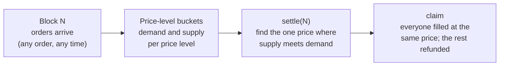
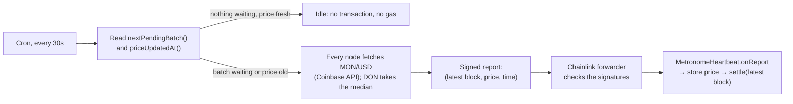

<div align="center">

# Metronome

### Fair execution for Monad: every block is one auction, and everyone gets the same price.

A fully onchain **frequent batch auction** exchange. No offchain matching engine, no solvers, no sequencer to trust.
Front-running and sandwich attacks stop working because **the order of transactions inside a block no longer matters.**

[Why](#the-problem) · [How it works](#how-it-works) · [Why Monad](#why-this-only-works-on-monad) · [Tracks](#tracks-and-bounties) · [Integrations](#integrations) · [Status](#status) · [Architecture](docs/architecture.md) · [Roadmap](docs/roadmap.md)

*Built for [Monad Metropolis](https://monad.xyz/developers/hackathons/metropolis) · Track 01: Onchain Finance & Trading*

</div>

---

## The problem

On today's onchain exchanges, **whoever gets ordered first wins**.

- On an **AMM**, each swap moves the price for the next one. A bot sees your swap in the mempool, buys just before you, and sells just after. You pay more; the bot keeps the difference. That's a *sandwich attack*.
- On an **order book**, matching is first-come-first-served. Speed and transaction ordering decide who gets filled, so the game becomes a latency race that normal users always lose.

Either way, users pay a hidden tax to whoever controls transaction ordering. Mobile and retail users, who tend to set loose slippage, pay the most.

## The solution

Metronome replaces "first come, first served" with **"everyone in the same block, at the same price"**.

1. You place a limit order (or a market order) during a block.
2. When the block ends, every order in it is cleared **together** at one uniform price: the price where supply meets demand.
3. You collect your fill a moment later, usually automatically.

Since all orders in a block get the same price, being first inside the block is worth nothing:

| A sandwich attempt | On an AMM | On Metronome |
|---|---|---|
| Bot buys before you | Pushes your price up | Joins the same batch as you |
| You buy | You pay the inflated price | You pay the batch's clearing price |
| Bot sells after you | Bot pockets the difference | Bot's buy and sell clear at the **same** price: profit 0, minus fees |
| **Your loss** | **Up to your full slippage limit** | **0** |

This is the **frequent batch auction**: a market design that economists proposed as a fix for high-frequency trading races. Metronome brings it fully onchain.

## How it works



- **Orders go into price-level buckets, not a queue.** Placing an order just adds its size to the bucket for its price, so there is nothing to jump ahead of.
- **Settling costs the same with 10 orders or 10,000.** Clearing walks price levels, not orders, using a bitmap to skip empty ones.
- **Makers post once.** Resting orders join a pool per price level and stay in every batch until filled or cancelled, so liquidity is there every block without re-posting. Makers pay no fee; takers pay 5 bps.
- **Claims are O(1) per user.** Taker orders read their batch's result; resting orders read their pool's running totals. A keeper claims for users, so trading feels like one tap.
- **Only the marginal price level is partly filled**, pro-rata. Every order at a better price fills completely. Every order at a worse price is fully refunded.
- **Nobody has to be trusted.** Anyone can call `settle`, and `claim` settles the batch itself if no one has yet.

### Chainlink CRE: the exchange's heartbeat and price feed

Batches don't depend on our server staying up. A [Chainlink CRE workflow](cre/metronome-heartbeat) settles them from Chainlink's network, and brings MON/USD from an off-chain API on-chain in the same report:



- **One report catches up on everything.** It settles every waiting batch up to the latest block, however far behind it is.
- **The receiver is also a price feed.** `MetronomeHeartbeat` serves the DON's median price as a Chainlink-style `IAggregatorV3`, so the market's oracle guard can void any batch that clears too far from MON/USD (planned for mainnet, where the workflow runs continuously; on testnet it runs as simulations, so the price isn't kept fresh and the guard stays off). Our market maker centers its quotes on this price. An API outage doesn't stop settlement: the report carries price 0, which the receiver ignores.
- **It adds no new power.** `settle` is open to anyone; [`MetronomeHeartbeat`](contracts/src/cre/MetronomeHeartbeat.sol) only accepts reports from Chainlink's forwarder, and any settle reward lands there for the owner to sweep.
- **Proven live on testnet (Oct 3):** with no keeper bot running, a real taker buy was [settled by the workflow](https://testnet.monadscan.com/tx/0x23421b9b8c6eb4098da8df6e313b5535facbda8d8be293f9f8862b08f8c7b7f0) within 4 seconds, with MON/USD in the same report. Also: a price-only report wrote MON/USD $0.03148 ([`0xc610…f57b`](https://testnet.monadscan.com/tx/0xc610c30620f1c50803008ded82506ce5eeec1a1d72cbc713cd7dd75e696cf57b)), and a settle report cleared a waiting batch with a fresh price ([`0xab20…c387`](https://testnet.monadscan.com/tx/0xab20831cb1395fe34511c3a1658336871d18f1b5d97b46f789a58eefe81fc387): forwarder → `onReport` → `PriceUpdated` → `BatchSettled` → `Heartbeat`).
- **Gas:** Monad charges for the gas *limit*, so each report's limit is sized from an estimate of the receiver call (× 2 + 250k, capped at 4M): ~324k for a price update, ~1.8M to settle a batch where takers fill against resting pools. A flat 1.5M ran out of gas on Oct 3; the workflow now also re-checks that each batch really settled, because the forwarder swallows a receiver that runs out of gas.

Full detail, including the clearing algorithm, storage layout and invariants: [`docs/architecture.md`](docs/architecture.md).

## Why this only works on Monad

A batch auction needs batches that are **short** (so prices stay fresh), **cheap to clear** (so it can run onchain), and **fair to order** (so no sequencer picks winners).

| | Batch = 1 block | What goes wrong |
|---|---|---|
| Ethereum | 12 s | Stale prices, and clearing onchain costs too much gas |
| L2 rollups | 0.25–2 s | A single sequencer orders everything; gas for clearing still adds up |
| Offchain batch auctions (e.g. CoW Protocol) | Varies | Matching happens offchain, run by solvers you have to trust |
| **Monad** | **~300 ms, fast finality, low gas** | **Real-time feel, fully onchain, no trusted party** |

### Built for Monad's parallel execution

Monad executes transactions in parallel and re-runs ones that touched the same storage. A naive exchange, where every order writes the same bucket, turns into a serial bottleneck. Metronome is designed around that:

- **Sharded buckets:** each batch's order book is split into K shards, and each user writes to their own shard. Orders from different users don't collide.
- **No global counters:** order IDs come from a per-user nonce, so placing an order touches only your own storage and your shard.
- **Page-aware layout:** price levels sit in a contiguous array, so neighbouring prices share a Monad storage page and settling reads fewer pages.
- **Measured, not claimed:** [our shard benchmark](docs/benchmark.md) (200 orders in one batch) shows sharding cuts
  the chain of conflicting orders in Metronome's storage from 24 (K=1) to 10 (K=16). It also shows what still
  serializes: every order's escrow transfer writes the exchange's token balance, which keeps the whole-transaction
  chain at ~100 for any K, while K=16 costs 3.2× the settle gas. The next step it points to is escrow from internal
  per-user balances.

## What makes it different

| | AMM | Onchain order book | Offchain batch auction | **Metronome** |
|---|---|---|---|---|
| Sandwich-proof | ✗ | Partly | ✓ | **✓** |
| Fully onchain matching | ✓ | ✓ | ✗ | **✓** |
| Ordering inside a block matters | Yes | Yes | No | **No** |
| Needs trusted solvers or operators | No | No | Yes | **No** |
| Limit orders | ✗ | ✓ | ✓ | **✓** |
| Price discovery | Formula | Continuous | Per batch | **Per block** |

## Product

A mobile-first trading app designed for people who have never used a wallet:

- **Log in with Face ID.** Your wallet comes from your passkey ([Mera](https://mera.category.xyz)): no seed phrase, no popups, no custody server.
- **One tap to trade** MON against a dollar stablecoin (AUSD, on testnet from Agora's faucet in one tap). Every trade shows its batch and clearing price.
- **Filled within about a second.** Funds arrive automatically; there is no "claim" button to find.
- **See the auction live:** supply and demand curves animate and cross every block.
- **Sandwich lab:** run the same attack against an AMM and against Metronome, side by side, and watch the victim's loss. Live on testnet: the AMM victim overpays 5.27%, the Metronome victim 0%; the app mints the test tokens a run needs.
- **Perps tab:** Perpl's perpetual futures markets (live prices, candles, order book) opening a Perpl account and trading perps (long/short at market, leverage, live position and P&L, one-tap close) from the same passkey wallet, straight on Perpl's contract.
- **Portfolio:** Metronome orders (with time and transaction from the indexer) next to the Perpl account and every open perp position.
- **Sub-accounts:** the same passkey derives more wallets (each its own Perpl account); switch in one tap, no popup.
- **Stats:** all-time volume, batches, traders, time to settlement, gas per action and keepers, from our Envio indexer.

## Tracks and bounties

One main track, plus sponsor bounties that the same product qualifies for. Details and official rules: [`tracks/`](tracks/README.md).

| Prize | What we submit | Status |
|---|---|---|
| **Track 01 — Onchain Finance & Trading** | Metronome itself: the batch-auction exchange, app and bots | Building; live on testnet |
| **Grand Champion** | The same project (considered automatically) | — |
| **Mera — Best Mera-Powered UX** | Face ID login, popup-free signing in the app | Integrated |
| **Mera — One Passkey, Many Keys** | One passkey derives the wallet key, sub-accounts, the Perpl API key and an encryption key | Integrated |
| **Envio — Best Use of Envio** | Indexer behind the Stats page and portfolio history | Integrated; hosted on Envio Cloud over HyperSync, public GraphQL: https://indexer.dev.hyperindex.xyz/5cebe67/v1/graphql |
| **Perpl — Best use of Perpl's API** | Perps tab: market data, account setup and trading in-app | Partial: market data over the API, account + long/short trades on the exchange contract live on testnet; API-key enrollment and API order entry wait on Perpl's origin whitelist |
| **Agora — Best Mobile Trading App** | Mobile app: passkey login, AUSD balance, Metronome and Perpl trades | Passkey → AUSD (faucet button) → Perpl trade works on testnet; filming on a real phone next |
| **Chainlink — Best CRE workflow** | CRE workflow that settles batches and brings MON/USD from an external API on-chain | Built; settle + price reports live on testnet via `simulate --broadcast` (accepted for the bounty) |
| **Nansen — Best use of Nansen** | MEV radar on Monad mainnet: who trades WMON (bots vs. everyone else) and verified sandwiches, from Nansen trades and labels | Built; first findings on `/radar` (snapshot from `pnpm radar`; Nansen labels skipped on the free plan's credits) |

## Integrations

| Partner | Role in Metronome | Status |
|---|---|---|
| **Monad** | Execution layer: 300 ms batches, parallel execution, cheap clearing | ✅ Live on testnet |
| **Mera** | Passkey login; one passkey derives the wallet key, the Perpl API key and a device encryption key; popup-free signing | ✅ In the app |
| **Envio** | HyperIndex indexer ([`indexer/`](indexer/README.md)) behind the Stats page; totals checked against raw chain logs | ✅ Hosted on Envio Cloud (Monad testnet, HyperSync); also runs locally in Docker |
| **Perpl** | Perps tab: live markets, candles and order book; open a Perpl account (approve, deposit, one-click trading) from the passkey wallet; paste an API key, stored encrypted with the passkey | ✅ Data, account setup and trading, live on testnet |
| **Agora AUSD faucet** | "Get 10,000 AUSD" button in the app calls Agora's testnet faucet; the same AUSD funds a Perpl account | ✅ Testnet |
| **AUSD** ([Agora](https://www.agora.finance)) | Quote asset of the mainnet market and Perpl collateral | ⏳ Mainnet |
| **Chainlink** | CRE workflow as the exchange's heartbeat: [`cre/metronome-heartbeat`](cre/metronome-heartbeat) settles every pending batch and stores a DON-median MON/USD price through a [receiver contract](contracts/src/cre/MetronomeHeartbeat.sol) that doubles as a price feed | ✅ Settle + price reports live on testnet via `simulate --broadcast` |
| **Nansen** | MEV radar (`/radar`, `pnpm radar`): Nansen DEX trades with trader labels and first funders, sandwich candidates verified block by block on mainnet. 5,000 WMON trades over 5.6 h on Oct 3 ($723k): 5 bot wallets made 75% of trades and 68% of volume (the top one alone 40%); 18 sandwich-shaped patterns, 0 verified on-chain (never front → victim → back in one block) | ✅ Monad mainnet |

## Where it goes next

Metronome is meant to be **infrastructure**, not a single app:

- **A fair-execution venue any Monad dApp can route through.** Wallets, aggregators and apps call one interface and get sandwich-proof fills.
- **More markets**, starting with the most-traded Monad pairs.
- **Revenue:** a small fee on filled volume, part of which pays whoever settles batches.

## Status

🚧 **In active development** for Monad Metropolis (submission Oct 12, 2026).

| Milestone | Target | |
|---|---|---|
| Architecture and roadmap | Sep 25 | ✅ |
| Core contract with differential fuzz + invariant tests | Oct 1 | ✅ |
| Resting (maker) orders: post once, fill across batches | — | ✅ |
| Deployed on Monad testnet: WMON/AUSD market [`0x44F6…10E5`](https://testnet.monadscan.com/address/0x44F6cF1A3c61AfCeAfF5017CA054b5754C2110E5) (redeployed Oct 4 with the price band from the security review; earlier markets in [`docs/network.md`](docs/network.md)) | Oct 1 | ✅ |
| Keeper + market-maker bots; end-to-end test on a local chain (sandwich: AMM victim −527 bps, Metronome 0) | Oct 3 | ✅ |
| Bots live on testnet: keeper + market maker, 3 taker fills between two wallets, each settled within 1–2 blocks | Oct 3 | ✅ |
| Mobile web app (Next.js PWA): trade, portfolio, batch explorer, sandwich lab | Oct 3 | ✅ |
| Sandwich lab live on testnet (own tWMON/tAUSD lab market): AMM victim −5.27%, Metronome 0% ([run](https://testnet.monadscan.com/tx/0x12915a346f7d4199f954d7c26e35b5f7bf783997ddf7a1577c70292a7c209712), [settle](https://testnet.monadscan.com/tx/0xa152acebf1f269c2efc30f80c02582f359d06322ded676bfac6da53264a66884)) | Oct 3 | ✅ Oct 4 |
| Passkey sub-accounts; Perpl positions in the portfolio | — | ✅ Oct 4 |
| Mera passkey login (one passkey → wallet key + Perpl key) | Oct 3 | ✅ |
| Perpl perps tab: live markets, account setup from the passkey wallet (live on testnet) | Oct 7 | ✅ |
| Perpl trading from the app (on-chain `execOrder`, no API key needed) | Oct 7 | ✅ live on testnet Oct 3 |
| End-to-end trade on a phone | Oct 7 | ⏳ |
| Envio indexer + Stats page | Oct 9 | ✅ |
| Shard benchmark K=1/4/16 ([results](docs/benchmark.md)) | Oct 10 | ✅ |
| Chainlink CRE workflow: built, 17 tests, settles batches and brings MON/USD on-chain, live on testnet ([details](#chainlink-cre-the-exchanges-heartbeat-and-price-feed)) | Oct 8 | ✅ |
| CRE workflow deployed on Chainlink's network | Oct 10 | ⏳ optional: Chainlink deploys simulated hackathon workflows; our deploy access is pending |
| Nansen MEV radar | Oct 10 | ✅ Oct 3 |
| Mainnet readiness: fork test against real WMON + AUSD, deploy script (K=4) dry-run | Oct 11 | ✅ Oct 4 |
| Monad mainnet deploy | Oct 11 | ⏳ needs ~3 MON + seed liquidity on mainnet |

**Tests:** 112 Foundry tests (unit, differential fuzz, invariants, gas and shard benchmarks, and a fork test against real mainnet WMON and AUSD) and 7 Go workflow tests, all run in CI (the fork test needs `MONAD_RPC_URL`).

**Monad testnet contracts**

| Contract | Address |
|---|---|
| Metronome (WMON/AUSD market, with the price band) | [`0x44F6cF1A3c61AfCeAfF5017CA054b5754C2110E5`](https://testnet.monadscan.com/address/0x44F6cF1A3c61AfCeAfF5017CA054b5754C2110E5) |
| MetronomeHeartbeat (CRE receiver, MON/USD feed) | [`0xBF310973D31a3766A1c943003f826a56F1986819`](https://testnet.monadscan.com/address/0xBF310973D31a3766A1c943003f826a56F1986819) |
| SandwichLab (with MiniAMM and a tWMON/tAUSD lab market) | [`0xc2E9492f6b45c9e709e2e4a43FBfD505Bf71f01b`](https://testnet.monadscan.com/address/0xc2E9492f6b45c9e709e2e4a43FBfD505Bf71f01b) |

Every verified address (tokens, oracles, CRE forwarders) is in [`docs/network.md`](docs/network.md). The demo video will be added here. Full plan: [`docs/roadmap.md`](docs/roadmap.md).

## Repository

```
docs/
  architecture.md   contract design, clearing algorithm, storage layout, testing
  roadmap.md        milestones, day-by-day plan, cut order, risks
  network.md        verified addresses: tokens, oracles, Chainlink CRE support, live runs
  benchmark.md      shard benchmark: gas and parallelism for K = 1, 4, 16
contracts/          Foundry: Metronome.sol, CRE receiver, libraries, tests, gas and shard benchmarks
bots/               keeper, market maker, taker, local end-to-end test, local stack, testnet fork
indexer/            Envio HyperIndex indexer (runs in Docker)
web/                Next.js mobile PWA: trade, perps, portfolio, stats, sandwich lab
cre/                Chainlink CRE workflow (Go): metronome-heartbeat settles batches and posts MON/USD
ideas/              original pitch
tracks/             hackathon track and bounty notes
```

## Built with

Solidity · Foundry · TypeScript · viem · Next.js · Mera · Perpl · Envio · Nansen · Chainlink CRE · Monad
