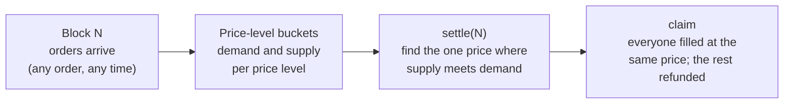

<div align="center">

# Metronome

### Fair execution for Monad: every block is one auction, and everyone gets the same price.

A fully onchain **frequent batch auction** exchange. No offchain matching engine, no solvers, no sequencer to trust.
Front-running and sandwich attacks stop working because **the order of transactions inside a block no longer matters.**

[Why](#the-problem) · [How it works](#how-it-works) · [Why Monad](#why-this-only-works-on-monad) · [Architecture](docs/architecture.md) · [Roadmap](docs/roadmap.md) · [Status](#status)

*Built for [Monad Metropolis](https://monad.xyz/developers/hackathons/metropolis) · Track 01: Onchain Finance & Trading*

</div>

---

## The problem

On today's onchain exchanges, **whoever gets ordered first wins**.

- On an **AMM**, each swap moves the price for the next one. A bot sees your swap in the mempool, buys just before you, and sells just after. You pay more; the bot keeps the difference. That's a *sandwich attack*.
- On an **order book**, matching is first-come-first-served. Speed and transaction ordering decide who gets filled, so the game becomes a latency race that normal users always lose.

Either way, users pay a hidden tax to whoever controls transaction ordering. Mobile and retail users, who tend to set loose slippage, pay the most.

## The solution

Metronome replaces "first come, first served" with **"everyone in the same block, at the same price"**.

1. You place a limit order (or a market order) during a block.
2. When the block ends, every order in it is cleared **together** at one uniform price: the price where supply meets demand.
3. You collect your fill a moment later, usually automatically.

Since all orders in a block get the same price, being first inside the block is worth nothing:

| A sandwich attempt | On an AMM | On Metronome |
|---|---|---|
| Bot buys before you | Pushes your price up | Joins the same batch as you |
| You buy | You pay the inflated price | You pay the batch's clearing price |
| Bot sells after you | Bot pockets the difference | Bot's buy and sell clear at the **same** price: profit 0, minus fees |
| **Your loss** | **Up to your full slippage limit** | **0** |

This is the **frequent batch auction**: a market design that economists proposed as a fix for high-frequency trading races. Metronome brings it fully onchain.

## How it works



- **Orders go into price-level buckets, not a queue.** Placing an order just adds its size to the bucket for its price, so there is nothing to jump ahead of.
- **Settling costs the same with 10 orders or 10,000.** Clearing walks price levels, not orders, using a bitmap to skip empty ones.
- **Makers post once.** Resting orders join a pool per price level and stay in every batch until filled or cancelled, so liquidity is there every block without re-posting. Makers pay no fee; takers pay 5 bps.
- **Claims are O(1) per user.** Taker orders read their batch's result; resting orders read their pool's running totals. A keeper (or a Chainlink CRE workflow) claims for users, so trading feels like one tap.
- **Only the marginal price level is partly filled**, pro-rata. Every order at a better price fills completely. Every order at a worse price is fully refunded.
- **Nobody has to be trusted.** Anyone can call `settle`, and `claim` settles the batch itself if no one has yet.

Full detail, including the clearing algorithm, storage layout and invariants: [`docs/architecture.md`](docs/architecture.md).

## Why this only works on Monad

A batch auction needs batches that are **short** (so prices stay fresh), **cheap to clear** (so it can run onchain), and **fair to order** (so no sequencer picks winners).

| | Batch = 1 block | What goes wrong |
|---|---|---|
| Ethereum | 12 s | Stale prices, and clearing onchain costs too much gas |
| L2 rollups | 0.25–2 s | A single sequencer orders everything; gas for clearing still adds up |
| Offchain batch auctions (e.g. CoW Protocol) | Varies | Matching happens offchain, run by solvers you have to trust |
| **Monad** | **~300 ms, fast finality, low gas** | **Real-time feel, fully onchain, no trusted party** |

### Built for Monad's parallel execution

Monad executes transactions in parallel and re-runs ones that touched the same storage. A naive exchange, where every order writes the same bucket, turns into a serial bottleneck. Metronome is designed around that:

- **Sharded buckets:** each batch's order book is split into K shards, and each user writes to their own shard. Orders from different users don't collide.
- **No global counters:** order IDs come from a per-user nonce, so placing an order touches only your own storage and your shard.
- **Page-aware layout:** price levels sit in a contiguous array, so neighbouring prices share a Monad storage page and settling reads fewer pages.
- **Measured, not claimed:** we'll publish a K=1 vs K=16 benchmark, whatever it shows.

## What makes it different

| | AMM | Onchain order book | Offchain batch auction | **Metronome** |
|---|---|---|---|---|
| Sandwich-proof | ✗ | Partly | ✓ | **✓** |
| Fully onchain matching | ✓ | ✓ | ✗ | **✓** |
| Ordering inside a block matters | Yes | Yes | No | **No** |
| Needs trusted solvers or operators | No | No | Yes | **No** |
| Limit orders | ✗ | ✓ | ✓ | **✓** |
| Price discovery | Formula | Continuous | Per batch | **Per block** |

## Product

A mobile-first trading app designed for people who have never used a wallet:

- **Log in with Face ID or email.** A wallet is created for you ([Privy](https://privy.io)): no seed phrase, no popups.
- **One tap to trade** MON against **AUSD**, [Agora](https://www.agora.finance)'s stablecoin. Every trade shows its batch and clearing price.
- **Filled within about a second.** Funds arrive automatically; there is no "claim" button to find.
- **See the auction live:** supply and demand curves animate and cross every block.
- **Sandwich lab:** run the same attack against an AMM and against Metronome, side by side, and watch the victim's loss.

## Integrations

| Partner | Role in Metronome |
|---|---|
| **Monad** | Execution layer: 300 ms batches, parallel execution, cheap clearing |
| **Agora (AUSD)** | Quote asset of the first market |
| **Privy** | Passkey login, embedded wallets, popup-free signing, in-app funding |
| **Chainlink** | CRE workflow as the exchange's heartbeat (settles and pays out every batch); price feed as a circuit breaker |

## Where it goes next

Metronome is meant to be **infrastructure**, not a single app:

- **A fair-execution venue any Monad dApp can route through.** Wallets, aggregators and apps call one interface and get sandwich-proof fills.
- **More markets**, starting with the most-traded Monad pairs.
- **Revenue:** a small fee on filled volume, part of which pays whoever settles batches.

## Status

🚧 **In active development** for Monad Metropolis (submission Oct 12, 2026).

| Milestone | Target | |
|---|---|---|
| Architecture and roadmap | Sep 25 | ✅ |
| Core contract with differential fuzz + invariant tests | Oct 1 | ✅ |
| Resting (maker) orders: post once, fill across batches (90 tests passing) | — | ✅ |
| Deployed on Monad testnet: [`0x99E4…a889`](https://testnet.monadscan.com/address/0x99E4DBCF8edE8092Be972307eB3d0Cd91ecBa889), taker and resting cycles verified live | Oct 1 | ✅ |
| Live market with keeper and market-maker bots; sandwich demo | Oct 3 | ⏳ |
| End-to-end trade on a phone | Oct 7 | ⏳ |
| Chainlink workflow and parallelism benchmark | Oct 9 | ⏳ |
| Monad mainnet | Oct 10 | ⏳ |

Contract addresses, test results, gas numbers and the demo video will be added here as they land. Full plan: [`docs/roadmap.md`](docs/roadmap.md).

## Repository

```
docs/
  architecture.md   contract design, clearing algorithm, storage layout, testing
  roadmap.md        milestones, day-by-day plan, cut order, risks
  network.md        verified addresses: tokens, oracles, Chainlink CRE support
contracts/          Foundry: Metronome.sol, libraries, tests
bots/               keeper, market maker, benchmark            (coming)
cre/                Chainlink CRE workflow                     (coming)
web/                Next.js mobile PWA                         (coming)
ideas/              original pitch
tracks/             hackathon track and bounty notes
```

## Built with

Solidity · Foundry · TypeScript · viem · Next.js · wagmi · Privy · Chainlink CRE · Monad
