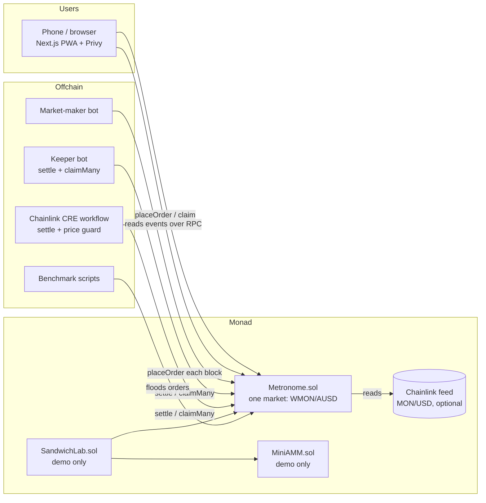

# Metronome — Architecture

Status: **decided, Sep 25 2026**. Change this doc before changing the design in code.

## 1. System overview



There is **no backend server and no indexer**. The frontend reads contract state and events directly over RPC. The bots are stateless scripts that anyone could run.

## 2. Core concepts

| Term | Meaning |
|---|---|
| **Batch** | All orders placed in one block. `batchId = block.number` |
| **Tick** | A discrete price level. `price(t) = P_MIN × 1.001^t`, so each tick is 10 bps apart |
| **Tick range** | `t ∈ [0, 4095]`, fixed at deploy. 1.001^4095 ≈ 60×, so the range covers P_MIN to about 60 × P_MIN |
| **Shard** | Each batch's order book is split into K copies. A user always writes to shard `uint160(owner) % K` |
| **Taker order** | Lives for one batch. Whatever doesn't fill is refunded at claim |
| **Resting order** | A maker order. It joins the **pool** for its (side, tick) and stays in every batch until filled or cancelled. Makers post once, not every block |
| **Pool** | All resting orders at one (side, tick), treated as one big order. Orders own **shares** of it |
| **Clearing tick t\*** | The single price every filled order in a batch trades at |
| **Marginal tick** | The only tick where orders may be partly filled (pro-rata) |

Base = WMON (18 decimals), quote = AUSD (6 decimals). The contract only handles ERC-20s. The frontend wraps MON into WMON when needed.

### Why resting orders

Taker-only batches looked simple, but on testnet (Sep 25: 0.30 s blocks, ~102 gwei, ~250k gas per order) a market maker re-posting a 10-level ladder every block would burn **~0.8 MON per second**. With pools, a maker posts once (~2.5M gas for 10 levels) and re-quotes only when the price moves.

## 3. Contracts

### 3.1 File layout

```
contracts/
  src/
    Metronome.sol          core market (place, settle, claim, cancel)
    lib/TickMath.sol       price(t) via binary exponentiation of 1.001
    lib/TickBitmap.sol     two-level bitmap of active ticks (set / unset / merge)
    lib/ClearingLib.sol    pure clearing algorithm (easy to fuzz on its own)
    interfaces/IMetronome.sol
    demo/MiniAMM.sol       x*y=k pool, only for the sandwich demo
    demo/SandwichLab.sol   runs the same sandwich on both venues
    mocks/MockERC20.sol, MockAggregator.sol
  test/  unit, fuzz, invariant, differential
  script/Deploy.s.sol
```

### 3.2 Storage

```solidity
struct Order {                  // 2 slots
    address owner; uint56 batchId; uint16 tick; bool isBuy; bool resting; bool closed;
    uint128 size;               // base units
    uint128 escrow;             // quote (buy) or base (sell) still locked
}

struct Book {                   // one per (batch, shard)
    TickBitmap.Map active;      // 16 words + 1 summary word
    Level[4096] takers;         // {uint128 buy; uint128 sell} per tick: one-batch orders
    Level[4096] resting;        // resting orders placed in this batch; they join their pool at settle
}

struct Pool { uint32 gen; uint128 remaining; uint256 shares; }  // current generation, per (side, tick)
struct PoolAcc { uint256 accA; uint256 accB; bool frozen; uint128 frozenRemaining; uint256 frozenShares; }
struct Join { uint32 gen; uint128 groupSize; uint256 minted; uint256 accA; uint256 accB; }  // per (batch, side, tick)

Pool[4096] buyPools; Pool[4096] sellPools;              // fixed arrays: page-friendly
TickBitmap.Map buyPoolTicks, sellPoolTicks;             // which pools are live
mapping(shard => mapping(batch => uint256)) shardNext;  // per-shard chain of batches with orders
```

**Parallel-friendly rules.** On Monad, transactions that write the same slot conflict and get re-executed. So `placeOrder` writes no global value:
- `orderId = keccak256(owner, nonce[owner])`: a per-user nonce, **not** a global counter
- Books and bitmaps are per shard, so two users in different shards never touch the same slot
- Resting orders go into the batch's shard book too; they only touch the global pools later, at settle
- The batch chain used to settle in order is **per shard**, appended by the shard's first order in a batch
- The reentrancy guard uses **transient** storage (OpenZeppelin's default guard writes one shared slot on every call)

### 3.3 External functions

| Function | Who | What it does |
|---|---|---|
| `placeOrder(isBuy, tick, size, resting) → orderId` | anyone | Pulls escrow into the current batch's shard book. Taker buy escrows `ceil(size × price(tick)) + fee`; resting buy escrows `ceil(size × price(tick))` plus 1000 raw units of buffer (makers pay no fee); a sell escrows `size` base |
| `settle(batchId)` | anyone, once `block.number > batchId` | Settles **every pending batch ≤ batchId, in order** (pools carry state from one batch to the next). Idempotent |
| `claim(orderId)` | anyone; funds always go to `order.owner` | Taker: pays the fill, refunds the rest, closes. Resting: pays what its pool earned since the last claim; closes once the pool generation is used up |
| `claimMany(ids)`, `settleAndClaim(batchId, ids)` | keeper / CRE | How users get funds with no second tap |
| `cancel(orderId)` | owner, resting orders only | Pays fills so far and returns the unfilled part. First settles every earlier batch, so a maker can never pull liquidity out of a batch that already closed |
| views: `price`, `quoteBuyEscrow`, `restingBuyEscrow`, `previewClaim`, `getBatchBook`, `getRestingBook`, `getPool`, `nextPendingBatch` | frontend, bots | |

Admin (owner, hackathon only): `pause()` (blocks new orders only; claims and cancels always work), `setOracle`, `setFees`, `withdrawFees`. The shard count K and the tick range are immutable.

### 3.4 Settling a batch

1. **Joins.** Resting orders placed in this batch join their pools *before* clearing, so they can trade in the batch they were placed in. A pool with `S` shares and `R` remaining mints `G × S / R` shares for a group of size `G` (1:1 for an empty pool). The batch records the pool's accumulators at join time.
2. **Clear.** Inputs per tick = taker size (merged across shards) + pool `remaining`. `ClearingLib` finds `t*` (below).
3. **Fill pools.** Each pool that traded is filled like one order of size `remaining`, and its per-share accumulators grow: sell pools `accA += proceeds / S`; buy pools `accA += base / S` and `accB += quote spent / S`.
4. **Freeze** a pool that drops below the minimum order size (or whose shares outgrow its size by 10¹²): its generation ends, the dust is no longer offered, and holders withdraw their share on their next claim.

Clearing (`ClearingLib`), with `D(t)` = buy size with limit ≥ t and `S(t)` = sell size with limit ≤ t:
1. Let `t0` = the lowest tick where `S(t0) ≥ D(t0)`. If there is none, `t0 = 4096` with `D = 0`.
2. If `D(t0) ≥ S(t0 − 1)`: **t\* = t0**, `V = D(t0)`, sellers at t0 get `(V − S(t0−1)) / sellAt(t0)`. Otherwise **t\* = t0 − 1**, `V = S(t0−1)`, buyers at t0−1 get `(V − D(t0)) / buyAt(t0−1)`.
3. **Price guard:** if an oracle is set and the feed is broken, stale, or `|price(t*) − oracle| > maxDeviation`, the batch is voided: nothing trades, everyone is refunded.

This picks the tick with the most volume, and only the marginal tick is ever rationed (differential fuzz against a brute force, §6). After a batch settles, the resting book can't cross (invariant-tested).

Cost is O(active ticks × K + live pools), never O(orders).

### 3.5 Claim math

A taker order's fill is `size`, `size × num / den` at the rationed marginal tick, or 0. A resting order owns `shares = minted × size / groupSize` and earns `shares × (acc_now − acc_last)`.

**Rounding rule: what a user gives is rounded up, and what a user receives is rounded down, each from their exact share.** Pools follow the same rule as one big order.

| | Receives (rounded down) | Gives (rounded up) |
|---|---|---|
| Buyer | `floor(fill)` base | `ceil(fill × price)` quote (+ fee for takers), from escrow. The rest is refunded |
| Seller | `floor(fill × price)` quote (− fee for takers) | `ceil(fill)` base, from escrow. The rest is refunded |

Quote is priced from the **exact** fractional fill, not from a rounded base amount. Rounding every order's base down and then pricing it would let a batch owe a few wei more than it holds. With this rule **the contract can never owe more than it holds**, and leftover dust only ever grows. The invariant tests check this with taker and resting orders, cancels and fee changes mixed together.

### 3.6 Fees and keeper reward

- **Takers pay 5 bps** on the quote amount of each fill. **Makers (resting orders) pay nothing**: that's the incentive to provide liquidity, and it means a fee change can never outgrow what a maker escrowed.
- A taker buy's fee is capped by its escrow, so a fee increase after placement can't lock funds.
- The fee pool pays the settler a fixed reward (`settleReward`) when a batch with volume is settled. The rest goes to the treasury (owner).

### 3.7 Monad-specific engineering (the judge story)

| Topic | What we do | How we prove it |
|---|---|---|
| Parallel execution | K shards, per-user nonces, per-shard batch chains, transient reentrancy guard: `placeOrder` writes no global slot | Benchmark K=1 vs K=16 (§5.6) |
| Storage pages (128 slots) | Books and pools are fixed arrays, so neighbouring ticks share a page | Gas per settle vs. number of active ticks |
| Gas is charged on the **gas limit**, not gas used | Frontend and bots set tight limits from `estimateGas` plus a margin | Shown in the write-up |
| 300ms blocks | One block = one batch; makers rest, so every batch has liquidity | Live visualizer |

## 4. Offchain components

All in TypeScript with **viem**, as one pnpm workspace.

```
bots/
  keeper/     watches OrderPlaced; for each finished batch calls settleAndClaim
  mm/         market maker
  bench/      parallelism benchmark
  sandwich/   script that drives SandwichLab for the demo
cre/          Chainlink CRE workflow
web/          Next.js PWA
```

### 4.1 Keeper
- Subscribes to new blocks. Keeps order IDs grouped by batch from `OrderPlaced` logs.
- When `block > B`: sends `settleAndClaim(B, ids)`, in chunks if there are many IDs.
- Stateless. If it restarts, it rescans the last N blocks for unclaimed orders.
- It's also the fallback for the CRE workflow.

### 4.2 Market-maker bot
- Reference price: the Chainlink feed if present, otherwise the last clearing price, otherwise a configured start price.
- Posts a ladder of **resting** orders (e.g. 5 bids and 5 asks, ±10–50 bps) once, and re-quotes only when the reference price moves past a threshold.
- Uses 2–3 wallets so its orders land in different shards.
- Stops quoting if one side's inventory falls under a threshold.

### 4.3 Frontend (`web/`)
Next.js App Router, wagmi + viem, Privy, Tailwind. Installable PWA.

| Page | Content |
|---|---|
| `/` Trade | Buy/sell ticket (amount + "max price" slider, or "market" = most extreme tick), last clearing price, live supply/demand chart for the current batch, "MEV-protected" badge |
| `/portfolio` | Open and filled orders, fill price, status (pending → settled → claimed) |
| `/batch/[id]` | Supply/demand curves for any past batch, clearing point, pro-rata info |
| `/lab` | Sandwich demo: AMM victim loss vs. Metronome victim loss, side by side |
| `/stats` | Volume, batches settled, gas per order/settle/claim, benchmark chart |

Data comes from `getLogs` over a sliding window plus `watchBlockNumber`. Queries are kept to small block ranges because of RPC limits.

### 4.4 Demo contracts
- **MiniAMM**: a minimal x·y=k pool with the same tokens, seeded with liquidity.
- **SandwichLab**: in one transaction it runs attacker buy → victim buy → attacker sell, first on MiniAMM and then on Metronome (all three orders in the same batch). It emits the victim's loss and the attacker's profit on each venue. That's deterministic, so it works every time on camera.

## 5. Track integrations

### 5.1 Track 01 — Onchain Finance & Trading (main)
- Everything in §3: fully onchain matching, with no offchain engine.
- The deliverables judges look at: a working testnet/mainnet market, tests, the sandwich demo, and Monad engineering (§3.7).

### 5.2 Grand Champion
- Pitch: "fair execution for all of Monad". Metronome is **infrastructure** that other dApps plug into.
- `IMetronome` interface plus a short "integrate in 20 lines" section in the README.
- A `/stats` page with real numbers, and a polished README with this diagram.
- Business model: fees (§3.6), more markets, a router for aggregators (post-hackathon).

### 5.3 Agora — Best Mobile Trading App (AUSD)
- **AUSD is the quote asset** of the only market.
- Mobile-first PWA: large one-handed ticket, bottom nav, installable, and fast since the trade is filled within ~1s.
- "Add AUSD" entry point (Privy funding if it supports Monad, otherwise a faucet link on testnet).
- Part of the demo is filmed on a real phone.
- **Gate:** confirm on the dashboard whether a PWA counts and whether a specific SDK is required. If native is required, wrap with Capacitor (about half a day).

### 5.4 Privy — beyond login
| Feature | Use |
|---|---|
| Passkey / email login | Onboarding with no seed phrase |
| Embedded wallet | Created automatically on first login |
| Headless signing (`showWalletUIs: false` for known actions) | place and claim with no popup |
| **Smart wallets + gas sponsorship** (if a Monad bundler/paymaster is available) | wrap + approve + placeOrder in **one** batched user operation, gas-free for new users |
| Funding | "Add AUSD" / "Add MON" |

Auto-claim is handled by our keeper/CRE (`claimMany`), so Privy session signers aren't needed.
**Gate:** confirm the bounty rules and that smart wallets work on Monad. Without them, fall back to embedded wallet + headless signing + funding, which is still beyond login.

### 5.5 Chainlink — Best CRE workflow
Workflow `metronome-heartbeat`:
1. Trigger: cron (or an EVM log trigger on `OrderPlaced`, if supported on Monad).
2. Read unsettled batches with orders (via `getLogs`).
3. Read the MON/USD feed and skip or flag if the price moved too far (the contract enforces this too).
4. Write `settleAndClaim` for each batch.
5. Log volume and clearing price.

The contract doesn't depend on CRE: `claim` auto-settles, and the keeper is the fallback.
**Gate:** confirm CRE can write to Monad and how often it can trigger. If it can't reach Monad, this bounty is dropped.

### 5.6 Parallelism benchmark
- Script funds 200 wallets and sends N `placeOrder` txs as fast as possible into the same blocks, against two deployments: K=1 and K=16.
- Measure: orders included per block, time to inclusion, and gas. If a local Monad node exposes execution stats, add re-execution counts.
- **Honesty rule:** publish whatever the numbers show. If the difference is small, say so and explain why.

## 6. Testing

| Kind | What |
|---|---|
| Unit | place/settle/claim paths, escrow maths, events, reverts (settle too early, double claim, paused) |
| TickMath | `price(t)` against an offchain high-precision table for every t; monotonic |
| **Differential fuzz** | `ClearingLib` vs. a brute-force clearing that tries every tick: same t\*, same V |
| **Invariant** (handler with many users, random orders, settles, claims) | 1) contract balances ≥ everything still owed; 2) base bought = base sold per batch; 3) no buyer pays above limit, no seller gets below limit; 4) only the marginal tick is rationed; 5) an order can be claimed once |
| Gas | `forge snapshot`: place, settle vs. active ticks (1, 10, 100, 1000), claim |
| Fork / testnet smoke | Deploy script + one full cycle on Monad testnet |

Target: 100% line coverage on `Metronome.sol` and the libs.

## 7. Security notes
- `ReentrancyGuard` on every state-changing entry point, checks-effects-interactions, SafeERC20.
- Fee-on-transfer and rebasing tokens aren't supported (only WMON and AUSD are listed).
- Minimum order size, to limit griefing by spamming thousands of ticks and making settle expensive.
- Oracle: staleness check and deviation bound. If the oracle is unset, the guard is off.
- Owner can pause placing orders. **Claims always keep working**, so funds can't get stuck.

## 8. Explicitly out of scope
Multiple markets, a router, an indexer, native-token escrow, and the Arc deployment (parked).
