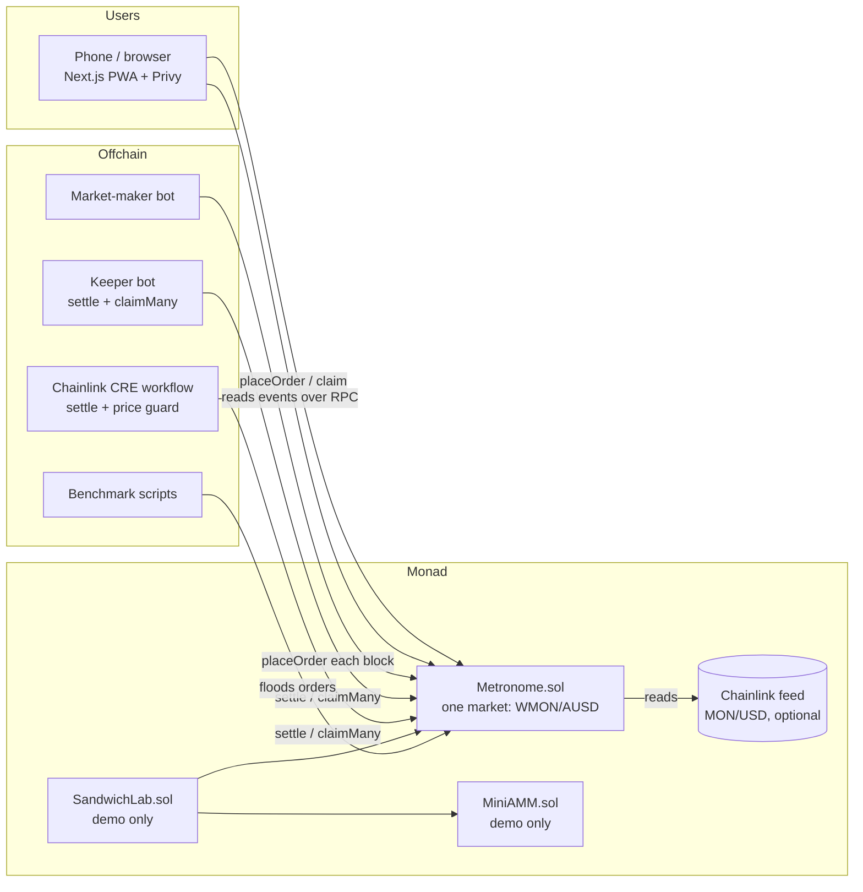

# Metronome — Architecture

Status: **decided, Sep 25 2026**. Change this doc before changing the design in code.

## 1. System overview



There is **no backend server and no indexer**. The frontend reads contract state and events directly over RPC. The bots are stateless scripts that anyone could run.

## 2. Core concepts

| Term | Meaning |
|---|---|
| **Batch** | All orders placed in one block. `batchId = block.number` |
| **Tick** | A discrete price level. `price(t) = P_MIN × 1.001^t`, so each tick is 10 bps apart |
| **Tick range** | `t ∈ [0, 4095]`, fixed at deploy. 1.001^4095 ≈ 60×, so the range covers P_MIN to about 60 × P_MIN |
| **Shard** | Each batch's order book is split into K copies. A user always writes to shard `uint160(owner) % K` |
| **Clearing tick t\*** | The single price every filled order in a batch trades at |
| **Marginal tick** | The only tick where orders may be partly filled (pro-rata) |

Base = WMON (18 decimals), quote = AUSD (6 decimals). The contract only handles ERC-20s. The frontend wraps MON into WMON when needed.

## 3. Contracts

### 3.1 File layout

```
contracts/
  src/
    Metronome.sol          core market (place, settle, claim)
    lib/TickMath.sol       price(t) via binary exponentiation of 1.001
    lib/TickBitmap.sol     two-level bitmap of active ticks
    lib/ClearingLib.sol    pure clearing algorithm (easy to fuzz on its own)
    interfaces/IMetronome.sol
    demo/MiniAMM.sol       x*y=k pool, only for the sandwich demo
    demo/SandwichLab.sol   runs the same sandwich on both venues in one tx
    mocks/MockERC20.sol, MockAggregator.sol
  test/  unit, fuzz, invariant, differential
  script/Deploy.s.sol, SeedLiquidity.s.sol
```

### 3.2 Storage

```solidity
struct Order {                 // 2 slots
    address owner;             // 160
    uint64  batchId;           // 64
    uint16  tick;              // 16
    bool    isBuy;             //  8
    bool    claimed;           //  8
    uint128 size;              // base units
    uint128 escrow;            // quote (buy) or base (sell) that was locked
}

struct Level { uint128 buy; uint128 sell; }  // 1 slot per tick, base units

struct Book {                  // one per (batch, shard)
    Level[4096] levels;        // contiguous slots, so nearby ticks share a Monad storage page
    TickBitmap.Map active;     // 16 words + 1 summary word
}

struct BatchResult {           // 2 slots
    bool    settled;
    uint16  clearingTick;
    uint8   rationed;          // 0 none, 1 buyers, 2 sellers
    uint128 volume;            // base units traded
    uint128 fillNum;           // pro-rata fraction for the marginal tick
    uint128 fillDen;
}

mapping(uint256 batchId => mapping(uint8 shard => Book)) books;
mapping(uint256 batchId => BatchResult) results;
mapping(bytes32 orderId => Order) orders;
mapping(address => uint64) nonces;
```

**Parallel-friendly rules.** On Monad, transactions that write the same slot conflict and get re-executed. So no transaction writes a global value:
- `orderId = keccak256(owner, nonce[owner])`: a per-user nonce, **not** a global counter
- Buckets and bitmaps are per shard, so two users in different shards never touch the same slot
- Nothing is written into `results[B]` during placement. Only `settle` writes it

### 3.3 External functions

| Function | Who | What it does |
|---|---|---|
| `placeOrder(bool isBuy, uint16 tick, uint128 size) → orderId` | anyone | Pulls escrow and adds `size` to `books[block.number][shard].levels[tick]`. Sets the bitmap bit. A buy escrows `ceil(size × price(tick) × (1 + fee))` quote, so the fee is always covered; a sell escrows `size` base |
| `settle(uint256 batchId)` | anyone, once `block.number > batchId` | Runs the clearing (below) and writes `results[batchId]`. Idempotent. If the batch is empty, it records `volume = 0` |
| `claim(bytes32 orderId)` | anyone; funds always go to `order.owner` | Calls `settle` first if needed, computes the fill, pays base/quote and refunds leftover escrow, then marks it claimed |
| `claimMany(bytes32[] ids)` | keeper / CRE | Loops `claim`. This is how users get funds with no second tap |
| `settleAndClaim(batchId, ids)` | keeper / CRE | Both in one tx |
| views: `quoteBuyEscrow`, `previewFill(orderId)`, `getLevels(batchId, from, to)`, `price(tick)` | frontend | |

There is **no cancel**: an order only lives for one block, and whatever doesn't fill is refunded at claim. There are no resting orders in the MVP; the MM bot re-quotes every block.

Admin (owner, hackathon only): `pause()`, `setOracle(addr, maxDeviationBps, maxStaleness)`, `setFee(bps)`. The shard count K and the tick range are immutable.

### 3.4 Clearing algorithm (`ClearingLib`)

Inputs come from summing the K shards over the ticks whose bitmap bit is set:
- `D(t)` = total buy size with limit ≥ t (falls as t rises)
- `S(t)` = total sell size with limit ≤ t (rises as t rises)

Steps:
1. OR the shard bitmaps together, then walk the active ticks in ascending order to build the running totals.
2. Let `t0` = the lowest tick where `S(t0) ≥ D(t0)`. If there is none, `t0 = 4096` with `D = 0`.
3. Choose between `t0` and `t0 − 1`:
   - If `D(t0) ≥ S(t0 − 1)`: **t\* = t0**, `V = D(t0)`. All buyers at ≥ t0 fill fully. Sellers below t0 fill fully. Sellers exactly at t0 get `(V − S(t0−1)) / sellAt(t0)`.
   - Else: **t\* = t0 − 1**, `V = S(t0−1)`. All sellers at ≤ t0−1 fill fully. Buyers above t0−1 fill fully. Buyers exactly at t0−1 get `(V − D(t0)) / buyAt(t0−1)`.
4. **Price guard:** if an oracle is set and `|price(t*) − oracle| > maxDeviation`, or the feed is stale, the batch is recorded as `volume = 0` and everyone is refunded.
5. Store `t*`, `V`, the rationed side and `fillNum/fillDen`.

This picks the tick with the most volume, and only the marginal tick is ever rationed. Both properties are checked by a differential fuzz test against a brute-force version (§6).

Cost is O(active ticks × K), not O(orders). The summary word means empty regions of the bitmap cost nothing.

### 3.5 Claim math

For an order at tick `t` in a batch with result `(t*, V, rationed, num/den)`:

| Order | Fill in base units |
|---|---|
| buy, `t > t*` / sell, `t < t*` | `size` |
| at `t == t*` on the rationed side | `size × num / den` (rounded **down**) |
| at `t == t*` on the other side | `size` |
| worse than `t*` | 0 |

- Buyer receives `fill` base and pays `ceil(fill × price(t*))` quote plus the fee. Refund = `escrow − paid − fee`.
- Seller receives `floor(fill × price(t*))` quote minus fee. Refund = `size − fill` base.
- **All rounding favours the contract.** Dust stays in the contract, and the invariant says it may only ever grow.

### 3.6 Fees and keeper reward

- Fee: **5 bps on the quote amount of each fill**, charged to both sides and accrued in the contract.
- The fee pool pays the settler a fixed reward (`settleReward`, e.g. 0.01 AUSD) when a batch with volume is settled. The rest goes to the treasury (owner).
- On testnet the fee can be 0. It's kept in the design because the Grand Champion pitch needs a business model.

### 3.7 Monad-specific engineering (the judge story)

| Topic | What we do | How we prove it |
|---|---|---|
| Parallel execution | K shards, per-user nonces, no global writes in `placeOrder` | Benchmark K=1 vs K=16 (§5.4) |
| Storage pages (128 slots) | `Level[4096]` is a fixed array, so ticks next to each other are on the same page and settle reads fewer pages | Gas per settle vs. number of active ticks |
| Gas is charged on the **gas limit**, not gas used | Frontend and bots set tight limits from `estimateGas` + 10% | Shown in the write-up |
| 300ms blocks | One block = one batch | Live visualizer |

## 4. Offchain components

All in TypeScript with **viem**, as one pnpm workspace.

```
bots/
  keeper/     watches OrderPlaced; for each finished batch calls settleAndClaim
  mm/         market maker
  bench/      parallelism benchmark
  sandwich/   script that drives SandwichLab for the demo
cre/          Chainlink CRE workflow
web/          Next.js PWA
```

### 4.1 Keeper
- Subscribes to new blocks. Keeps order IDs grouped by batch from `OrderPlaced` logs.
- When `block > B`: sends `settleAndClaim(B, ids)`, in chunks if there are many IDs.
- Stateless. If it restarts, it rescans the last N blocks for unclaimed orders.
- It's also the fallback for the CRE workflow.

### 4.2 Market-maker bot
- Reference price: the Chainlink feed if present, otherwise the last clearing price, otherwise a configured start price.
- Every block: posts a ladder of 5 buy and 5 sell orders around the reference (±10–50 bps), sized by inventory.
- Uses 2–3 wallets so its orders land in different shards.
- Stops quoting if one side's inventory falls under a threshold.

### 4.3 Frontend (`web/`)
Next.js App Router, wagmi + viem, Privy, Tailwind. Installable PWA.

| Page | Content |
|---|---|
| `/` Trade | Buy/sell ticket (amount + "max price" slider, or "market" = most extreme tick), last clearing price, live supply/demand chart for the current batch, "MEV-protected" badge |
| `/portfolio` | Open and filled orders, fill price, status (pending → settled → claimed) |
| `/batch/[id]` | Supply/demand curves for any past batch, clearing point, pro-rata info |
| `/lab` | Sandwich demo: AMM victim loss vs. Metronome victim loss, side by side |
| `/stats` | Volume, batches settled, gas per order/settle/claim, benchmark chart |

Data comes from `getLogs` over a sliding window plus `watchBlockNumber`. Queries are kept to small block ranges because of RPC limits.

### 4.4 Demo contracts
- **MiniAMM**: a minimal x·y=k pool with the same tokens, seeded with liquidity.
- **SandwichLab**: in one transaction it runs attacker buy → victim buy → attacker sell, first on MiniAMM and then on Metronome (all three orders in the same batch). It emits the victim's loss and the attacker's profit on each venue. That's deterministic, so it works every time on camera.

## 5. Track integrations

### 5.1 Track 01 — Onchain Finance & Trading (main)
- Everything in §3: fully onchain matching, with no offchain engine.
- The deliverables judges look at: a working testnet/mainnet market, tests, the sandwich demo, and Monad engineering (§3.7).

### 5.2 Grand Champion
- Pitch: "fair execution for all of Monad". Metronome is **infrastructure** that other dApps plug into.
- `IMetronome` interface plus a short "integrate in 20 lines" section in the README.
- A `/stats` page with real numbers, and a polished README with this diagram.
- Business model: fees (§3.6), more markets, a router for aggregators (post-hackathon).

### 5.3 Agora — Best Mobile Trading App (AUSD)
- **AUSD is the quote asset** of the only market.
- Mobile-first PWA: large one-handed ticket, bottom nav, installable, and fast since the trade is filled within ~1s.
- "Add AUSD" entry point (Privy funding if it supports Monad, otherwise a faucet link on testnet).
- Part of the demo is filmed on a real phone.
- **Gate:** confirm on the dashboard whether a PWA counts and whether a specific SDK is required. If native is required, wrap with Capacitor (about half a day).

### 5.4 Privy — beyond login
| Feature | Use |
|---|---|
| Passkey / email login | Onboarding with no seed phrase |
| Embedded wallet | Created automatically on first login |
| Headless signing (`showWalletUIs: false` for known actions) | place and claim with no popup |
| **Smart wallets + gas sponsorship** (if a Monad bundler/paymaster is available) | wrap + approve + placeOrder in **one** batched user operation, gas-free for new users |
| Funding | "Add AUSD" / "Add MON" |

Auto-claim is handled by our keeper/CRE (`claimMany`), so Privy session signers aren't needed.
**Gate:** confirm the bounty rules and that smart wallets work on Monad. Without them, fall back to embedded wallet + headless signing + funding, which is still beyond login.

### 5.5 Chainlink — Best CRE workflow
Workflow `metronome-heartbeat`:
1. Trigger: cron (or an EVM log trigger on `OrderPlaced`, if supported on Monad).
2. Read unsettled batches with orders (via `getLogs`).
3. Read the MON/USD feed and skip or flag if the price moved too far (the contract enforces this too).
4. Write `settleAndClaim` for each batch.
5. Log volume and clearing price.

The contract doesn't depend on CRE: `claim` auto-settles, and the keeper is the fallback.
**Gate:** confirm CRE can write to Monad and how often it can trigger. If it can't reach Monad, this bounty is dropped.

### 5.6 Parallelism benchmark
- Script funds 200 wallets and sends N `placeOrder` txs as fast as possible into the same blocks, against two deployments: K=1 and K=16.
- Measure: orders included per block, time to inclusion, and gas. If a local Monad node exposes execution stats, add re-execution counts.
- **Honesty rule:** publish whatever the numbers show. If the difference is small, say so and explain why.

## 6. Testing

| Kind | What |
|---|---|
| Unit | place/settle/claim paths, escrow maths, events, reverts (settle too early, double claim, paused) |
| TickMath | `price(t)` against an offchain high-precision table for every t; monotonic |
| **Differential fuzz** | `ClearingLib` vs. a brute-force clearing that tries every tick: same t\*, same V |
| **Invariant** (handler with many users, random orders, settles, claims) | 1) contract balances ≥ everything still owed; 2) base bought = base sold per batch; 3) no buyer pays above limit, no seller gets below limit; 4) only the marginal tick is rationed; 5) an order can be claimed once |
| Gas | `forge snapshot`: place, settle vs. active ticks (1, 10, 100, 1000), claim |
| Fork / testnet smoke | Deploy script + one full cycle on Monad testnet |

Target: 100% line coverage on `Metronome.sol` and the libs.

## 7. Security notes
- `ReentrancyGuard` on every state-changing entry point, checks-effects-interactions, SafeERC20.
- Fee-on-transfer and rebasing tokens aren't supported (only WMON and AUSD are listed).
- Minimum order size, to limit griefing by spamming thousands of ticks and making settle expensive.
- Oracle: staleness check and deviation bound. If the oracle is unset, the guard is off.
- Owner can pause placing orders. **Claims always keep working**, so funds can't get stuck.

## 8. Explicitly out of scope
Orders that last more than one batch, cancel, multiple markets, a router, an indexer, native-token escrow, and the Arc deployment (parked).
